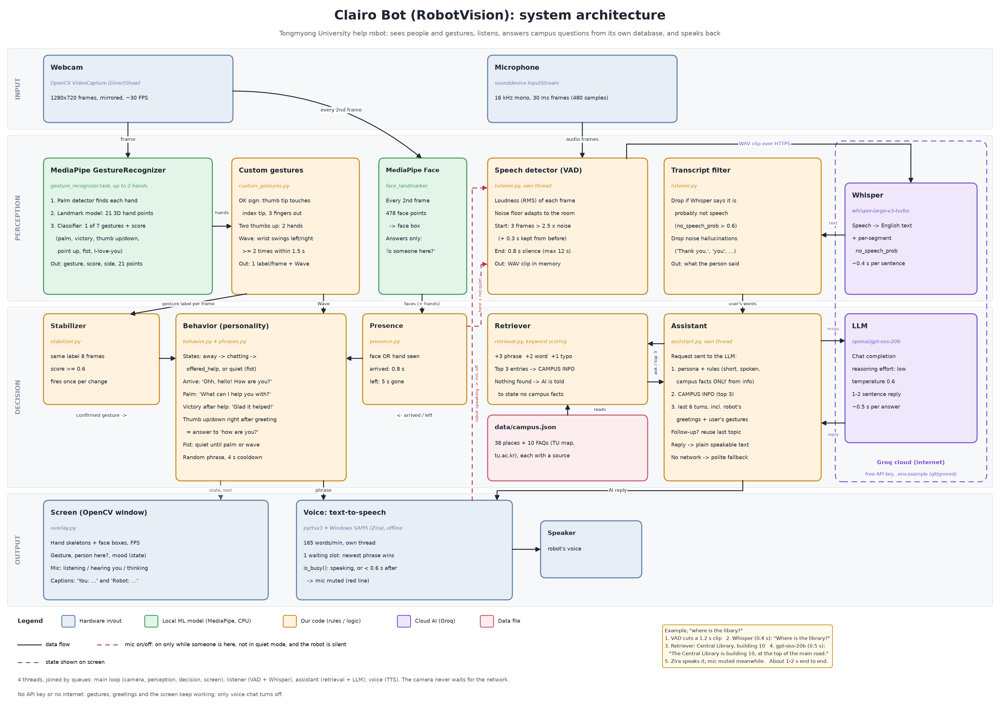

# Clairo Bot

**A friendly campus help robot for Tongmyong University, Busan.**

Clairo Bot watches through a camera and listens through a microphone. When someone walks up, it
greets them, reacts to hand gestures, and holds a short spoken conversation. It answers questions
about the campus (buildings, offices, opening hours, buses, the shuttle) using its own curated
database, so its answers stay grounded in real campus information rather than guesses.

> **Status:** working prototype on Windows (laptop webcam, mic and speakers). The plan is to run
> the robot's microphone, speaker and camera on an ESP32-S3 board that streams to this software
> over Wi-Fi.


<sub>Click the image for full size. Regenerate it with `python docs/make_architecture.py`.</sub>

---

## Contents

- [Features](#features)
- [How it works](#how-it-works)
- [Requirements](#requirements)
- [Installation](#installation)
- [Running](#running)
- [Interacting with the robot](#interacting-with-the-robot)
- [Campus knowledge base](#campus-knowledge-base)
- [Configuration](#configuration)
- [Testing](#testing)
- [Project structure](#project-structure)
- [Privacy and data](#privacy-and-data)
- [Troubleshooting](#troubleshooting)
- [Roadmap](#roadmap)

---

## Features

- **Person detection.** Greets people when they arrive ("Ohh, hello! How are you?") and says
  goodbye when they leave, using MediaPipe face and hand detection.
- **Gesture recognition.** Recognises 7 built-in gestures plus 3 custom ones: wave, OK sign and
  two thumbs up.
- **Voice conversation.** Speech-to-text with Groq Whisper, replies from an LLM (Groq
  `openai/gpt-oss-20b`), spoken aloud with offline text-to-speech. About 1-2 seconds from the end
  of a question to the start of the answer.
- **Grounded campus answers.** Retrieval over `data/campus.json`, built from the official campus map
  and tu.ac.kr. If something isn't in the database, the robot says it doesn't know and points to
  the main office; it doesn't make up places or times.
- **Personality with context.** Replies depend on the conversation so far. A victory sign after
  "What can I help you with?" means "thanks, that helped". A thumbs up right after "How are you?"
  means "I'm good". Phrases are picked at random, so it doesn't sound like a recording.
- **Never hears itself.** The microphone is muted while the robot speaks, and listens only while
  someone is present.
- **Degrades gracefully.** Without internet or an API key, gestures, greetings and the on-screen
  display keep working; only voice chat turns off.

## How it works

The diagram above shows the full pipeline. In short:

| Stage | Component | What it does |
|---|---|---|
| Input | Webcam (OpenCV) | 1280x720 frames, mirrored |
| | Microphone (sounddevice) | 16 kHz mono audio in 30 ms frames |
| Perception | **MediaPipe GestureRecognizer** (local) | Finds up to 2 hands, 21 landmarks each, classifies 1 of 7 gestures |
| | Custom gestures | OK sign from landmark geometry, wave from wrist motion over 1.5 s |
| | **MediaPipe FaceLandmarker** (local) | Detects faces, used only to know whether someone is present |
| | Speech detector (VAD) | Finds where a sentence starts and ends, adapting to background noise |
| | **Whisper** `whisper-large-v3-turbo` (Groq) | Turns the speech clip into English text |
| Decision | Stabilizer, Presence | Removes flicker: a gesture must hold 8 frames; a person must stay 0.8 s |
| | Behavior | Conversation state machine and personality (`phrases.py`) |
| | Retriever | Finds the 3 most relevant campus entries for a question |
| | Assistant + **LLM** `openai/gpt-oss-20b` (Groq) | Writes a 1-2 sentence spoken reply from the campus facts and recent conversation |
| Output | Text-to-speech (pyttsx3, offline) | Speaks the reply with the Windows "Zira" voice |
| | Screen (OpenCV window) | Hand skeletons, face boxes, mood, mic status, captions |

The camera loop, the listener, the AI assistant and the voice each run in their own thread,
connected by queues, so the video never freezes while waiting for the network.

## Requirements

| | |
|---|---|
| **OS** | Windows 10/11 (text-to-speech uses Windows SAPI5 voices; the camera uses DirectShow) |
| **Python** | 3.13 |
| **Package manager** | [uv](https://docs.astral.sh/uv/) |
| **Hardware** | Webcam, microphone, speakers |
| **Internet** | Needed for voice chat only |
| **API key** | Free [Groq API key](https://console.groq.com/keys) for voice chat |

The two MediaPipe models the app needs (`gesture_recognizer.task`, `face_landmarker.task`) are
included in the repository.

## Installation

```bash
git clone https://github.com/aayush-pokhrel/Clairo_Bot.git
cd Clairo_Bot
uv sync
```

**Add your Groq API key.** Create a file named `.env` in the project folder:

```
GROQ_API_KEY=gsk_your_key_here
```

The app also reads the key from `.env.example` if you keep it there. Both files are in
`.gitignore`, so the key is never committed. Never paste the key into any other file.

## Running

```bash
uv run python -m robotvision.main
```

You can also run `python robotvision/main.py` directly, or use your editor's Run button.
Press **`q`** in the video window to quit.

On start-up, MediaPipe prints a few `WARNING` / `INFO` / `W0000` lines. These are normal.
A working start looks like this:

```
[chat] Voice chat on (openai/gpt-oss-20b). Talk when a person is detected.
[person arrived] -> Oh, hey there! How are you doing? I'm Nova, nice to meet you.
[heard in 0.4s] Where is the library?
[ai] -> The Central Library is building 10, right at the top of the main road behind the big field.
```

## Interacting with the robot

### Talking

Stand in front of the camera. When the screen shows `Mic: listening`, just talk. Examples:

- "Where is the library?" and then "Is it open on Sunday?" (follow-ups work)
- "I'm hungry, is there halal food?"
- "Where is building 17?"
- "How do I get to Seomyeon by bus?"
- "I'm an international student, where do I register for courses?"
- "Tell me a joke."

### Gestures

| Gesture | Robot's response (one of several variations) |
|---|---|
| Open palm | "Hii! What can I help you with today?" |
| Wave | "Hey! Waving right back at you!" |
| Victory (V) after it offered help | "Yay, I'm so happy that helped!" |
| Victory (otherwise) | "Peace! Hope you're having a good day." |
| Thumb up / down right after "How are you?" | "Glad you're doing well!" / "Aww, I'm sorry to hear that..." |
| Thumb up / down | "Awesome!" / "Oh no, sorry about that..." |
| Two thumbs up | "Two thumbs up? You're making me blush!" |
| OK sign | "Perfect, sounds good!" |
| Pointing up | "Ooh, you have a question? I'm all ears." |
| I love you (🤟) | "Aww, love you too!" |
| Closed fist | Goes quiet (mic off) until it sees an open palm or a wave |

All phrases live in [`robotvision/phrases.py`](robotvision/phrases.py) and can be edited freely.

## Campus knowledge base

Everything the robot knows about the university is in [`data/campus.json`](data/campus.json):

- **38 places** covering all 48 numbered locations on the official campus map, with Korean names,
  building numbers, location hints, what's inside, hours and phone numbers.
- **10 FAQs**: address, buses and subway, phone numbers, dormitory rules, colleges, admissions,
  the president, accessibility, and more.
- Every entry has a `source` field saying where the information came from.

```json
{
  "name": "Central Library",
  "korean_name": "중앙도서관",
  "aliases": ["library", "libary", "books", "reading room", "study", "borrow", "10"],
  "building_number": "10",
  "location": "At the top of the main road, behind the big field (Main Field 1, 32).",
  "hours": "During the semester the open reading room on the 1st floor is open every day ...",
  "source": "tu.ac.kr/english/sub05_01.do; campus map"
}
```

**How retrieval works.** The question is reduced to its key words, and each entry is scored
against its name and `aliases`: +3 for a matching phrase, +2 per matching word, +1 for a close
misspelling such as "libary". The top 3 entries are given to the LLM as its only source of campus
facts. If nothing matches, the LLM is told not to state any campus facts. Follow-up questions such
as "when does it close?" reuse the previous topic.

**Editing the data.**

- Add words people might say to a place's `aliases`, such as "printer" or "bank".
- Set `robot_location` at the top of the file to where the robot stands (for example
  "inside Main Gate 1, next to the fountain"), and directions will start from there.
- The `location` hints were read off the campus map. Check them on site before deployment.
- After editing, run the tests (below).

Data was collected on 2026-11-24 from the official sites [tu.ac.kr/english](https://www.tu.ac.kr/english/),
[tu.ac.kr/tour](https://www.tu.ac.kr/tour/sub01_04.do), [tour.tu.ac.kr/ic](https://tour.tu.ac.kr/ic/sub01_11.do)
and the official campus map.

## Configuration

All settings are in [`robotvision/config.py`](robotvision/config.py). The most useful ones:

| Setting | Default | Meaning |
|---|---|---|
| `ROBOT_NAME` | `"Nova"` | Name it introduces itself with |
| `CAMERA_INDEX` | `0` | Try `1` or `2` if the wrong camera opens |
| `VOICE_NAME` | `"Zira"` | Installed Windows voice (`"Zira"`, `"David"`, or `None`) |
| `VOICE_RATE` | `165` | Speaking speed in words per minute |
| `LLM_MODEL` | `"openai/gpt-oss-20b"` | `"openai/gpt-oss-120b"` is smarter but slower |
| `STT_MODEL` | `"whisper-large-v3-turbo"` | Speech-to-text model |
| `HISTORY_TURNS` | `6` | Back-and-forths remembered per visitor |
| `MIC_DEVICE` | `None` | Microphone index or name (list them with `python -m sounddevice`) |
| `MIC_MIN_RMS` | `300` | Loudness needed to count as speech. Raise it in noisy halls |
| `MIC_SILENCE_SECONDS` | `0.8` | Pause length that ends a sentence |
| `ARRIVE_SECONDS` / `LEAVE_SECONDS` | `0.8` / `5.0` | How long before greeting / saying goodbye |
| `HOLD_FRAMES` / `MIN_CONFIDENCE` | `8` / `0.6` | Gesture stability and confidence threshold |
| `COOLDOWN_SECONDS` | `4.0` | Minimum time before reacting to the same gesture again |
| `WAVE_SWING_SIZE` | `0.4` | Lower it if waves aren't detected, raise it if they trigger too easily |
| `CHAT_ENABLED` | `True` | Set `False` to run gestures only |

## Testing

The retrieval tests check 56 realistic questions: direct questions, paraphrases, typos, building
numbers, and off-topic small talk that should match nothing.

```bash
uv run python tests/test_retriever.py
```

```
direct: 12/12 found in top 3, 12/12 ranked first
paraphrase: 24/24 found in top 3, 24/24 ranked first
typos_and_mishearing: 7/7 found in top 3, 6/7 ranked first
building_numbers: 7/7 found in top 3, 7/7 ranked first
off_topic: 6/6 found in top 3, 6/6 ranked first
TOTAL: 56/56 passed (top 3), 55/56 ranked first
```

The file also works with `pytest` if it is installed. When you add data, add a test case for it
in `tests/test_retriever.py`.

## Project structure

```
Clairo_Bot/
├── robotvision/
│   ├── main.py                  Main loop: capture -> perceive -> decide -> respond -> draw
│   ├── config.py                All settings
│   ├── phrases.py               Everything the robot says (random variations)
│   ├── camera.py                Webcam capture, mirror flip, FPS
│   ├── perception/
│   │   ├── hands.py             MediaPipe GestureRecognizer
│   │   ├── face.py              MediaPipe FaceLandmarker (person detection)
│   │   └── custom_gestures.py   OK sign, two thumbs up, wave
│   ├── speech/
│   │   └── listener.py          Mic -> speech detection -> Groq Whisper
│   ├── knowledge/
│   │   └── retriever.py         Finds campus entries relevant to a question
│   ├── logic/
│   │   ├── stabilizer.py        A gesture must hold N frames before it counts
│   │   ├── presence.py          Person arrived / left events
│   │   ├── behavior.py          Personality and conversation state
│   │   └── assistant.py         LLM replies grounded in campus data
│   └── feedback/
│       ├── voice.py             Offline text-to-speech (pyttsx3)
│       └── overlay.py           On-screen display
├── data/campus.json             Campus knowledge base
├── tests/test_retriever.py      Retrieval tests
├── docs/
│   ├── architecture.png         System diagram
│   └── make_architecture.py     Script that draws the diagram
├── gesture_recognizer.task      MediaPipe hand gesture model
├── face_landmarker.task         MediaPipe face model
└── pyproject.toml / uv.lock     Dependencies
```

## Privacy and data

- **Video never leaves the machine.** Face and hand detection run locally, and no images are
  stored or sent anywhere.
- **Speech is sent to Groq** for transcription, and the transcribed text is sent to Groq's LLM.
  Recording happens only while a person is detected, and nothing is saved to disk. Groq states
  that it does not retain inference data by default; check their current policy before public
  deployment.
- **Conversations are forgotten** as soon as the person leaves.
- **The API key** stays in a gitignored file on the machine.

For a public deployment on campus, consider a visible notice that the robot uses a camera and a
microphone.

## Troubleshooting

| Problem | Fix |
|---|---|
| `ModuleNotFoundError: No module named 'robotvision'` | Run from the project folder: `uv run python -m robotvision.main` |
| `Camera 0 didn't open` | Set `CAMERA_INDEX` to `1` or `2`, or close other apps using the camera |
| `[chat] No GROQ_API_KEY ... voice chat off` | Add `GROQ_API_KEY=...` to `.env` in the project folder |
| Mic stays on "listening" while you talk | Raise the Windows mic volume, or lower `MIC_MIN_RMS` |
| It reacts to background noise | Raise `MIC_MIN_RMS` |
| Wrong microphone | Run `python -m sounddevice` and set `MIC_DEVICE` |
| "I'm having a little trouble thinking right now" | No internet, or Groq's free rate limit was reached. Wait a minute |
| Gives a wrong or missing campus answer | Add aliases or facts in `data/campus.json`, then run the tests |
| No voice output | Check that the Zira voice is installed (Settings > Time & Language > Speech), or set `VOICE_NAME = None` |

## Roadmap

- [ ] ESP32-S3 hardware client: stream microphone, speaker and camera over Wi-Fi to this software
- [ ] Set `robot_location` and verify every location hint on campus
- [ ] Add missing data: cafeteria hours, office hours, health center, Wi-Fi help
- [ ] Headless mode (no video window) and auto-start on boot for deployment
- [ ] More natural cloud text-to-speech voice (optional)

## Built with

[MediaPipe](https://ai.google.dev/edge/mediapipe) ·
[OpenCV](https://opencv.org/) ·
[Groq](https://groq.com/) (Whisper, gpt-oss-20b) ·
[pyttsx3](https://pypi.org/project/pyttsx3/) ·
[sounddevice](https://python-sounddevice.readthedocs.io/) ·
[uv](https://docs.astral.sh/uv/)
